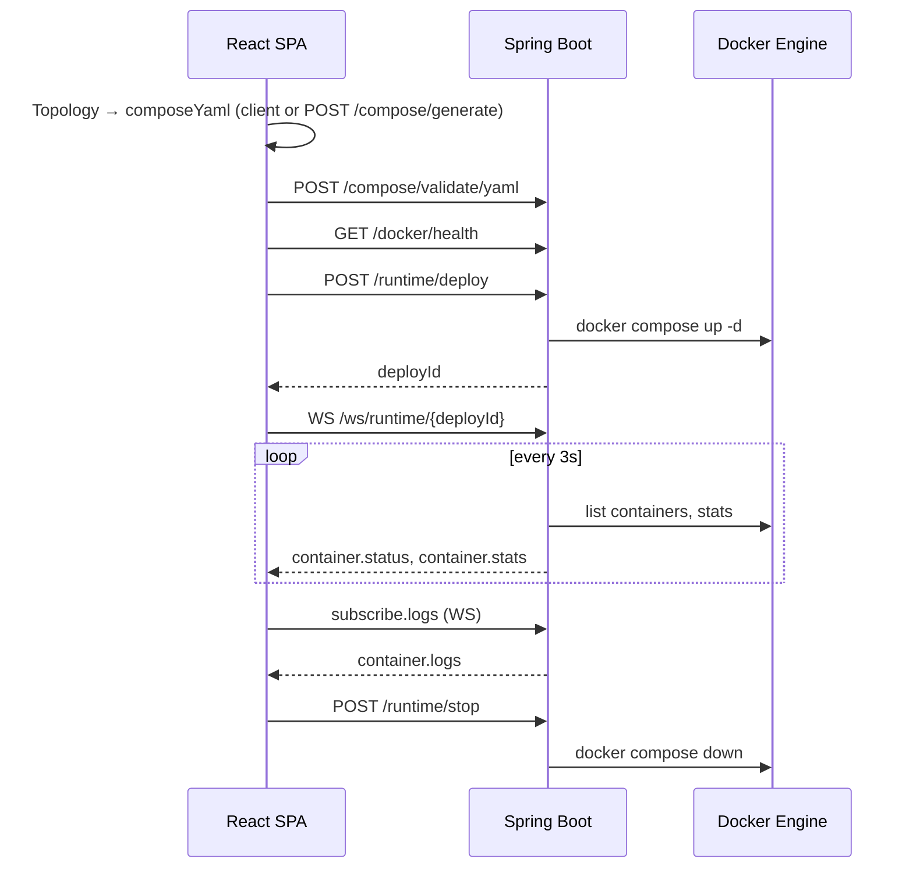

# System Architecture

> **Language:** [English](ARCHITECTURE.md) · [中文](../zh/ARCHITECTURE.md)

**Repository:** [https://github.com/MMCISAGOODMAN/docker-compose-studio](https://github.com/MMCISAGOODMAN/docker-compose-studio)

Docker Compose Studio is a visual orchestration platform for local development environments. Developers drag services onto a canvas, configure them, and export or run production-ready `docker-compose.yml` files without memorizing Compose syntax.

## Design Goals

| Goal | Approach |
|------|----------|
| Fast iteration | Client-side compose generation works without a backend |
| Accurate YAML | Server-side parse/generate/diff for complex topologies |
| Local runtime | One-click deploy via Docker Engine on the host |
| Extensibility | JSON catalog, template seeds, custom services in browser storage |

## High-Level Architecture

```
┌─────────────────────────────────────────────────────────────────────────┐
│                     React SPA (Vite + TypeScript)                       │
│  React Flow Canvas · Monaco Editor · Zustand Stores · Tailwind CSS      │
└───────────────────────────────┬─────────────────────────────────────────┘
                                │ REST /api/v1  ·  WebSocket /ws/runtime/*
                                ▼
┌─────────────────────────────────────────────────────────────────────────┐
│              Spring Boot 3 API (Java 21)                                │
│  Controllers · Services · JPA · Flyway · WebSocket Handler              │
└───────┬─────────────────┬──────────────────────┬──────────────────────┘
        │                 │                      │
        ▼                 ▼                      ▼
  PostgreSQL          Redis (reserved)     Docker Engine
  (projects,          for future            (compose up/stop,
   templates,          caching/sessions)     logs, stats)
   deploy history)
```

In development, Vite proxies `/api` and `/ws` to the backend on port `8080`.

## Runtime Subsystem (v0.2)

The runtime layer deploys generated compose files to the local Docker Engine and streams live telemetry to the UI.

```
RuntimePanel (React)
    │ POST /api/v1/runtime/deploy
    │ POST /api/v1/runtime/stop
    │ GET  /api/v1/runtime/containers?deployId=
    │ WS   /ws/runtime/{deployId}
    ▼
RuntimeController · RuntimeWebSocketHandler
    ▼
DockerRuntimeService · DeploySessionManager
    ▼
docker compose CLI  +  docker-java API (health, stats, logs)
```

**Deploy flow**

1. Frontend sends `composeYaml` and optional `projectName` to `POST /api/v1/runtime/deploy`.
2. `DockerRuntimeService` writes YAML under `dcs.docker.deploy-dir`, runs `docker compose up -d`, and registers a `DeploySession` with a UUID `deployId`.
3. Frontend opens `WebSocket /ws/runtime/{deployId}` for container status (every 3s), CPU/memory stats, and optional log streaming.
4. `POST /api/v1/runtime/stop` runs `docker compose down` and tears down the session.

Docker integration is gated by `DOCKER_ENABLED=true` (see `application.yml`). The root `docker-compose.yml` mounts `/var/run/docker.sock` into the backend container when running the full stack.

## Module Breakdown

### Frontend (`frontend/`)

| Area | Responsibility |
|------|----------------|
| `components/canvas/` | React Flow topology graph, drag-and-drop from marketplace |
| `components/marketplace/` | Service catalog + custom service dialog |
| `components/config/` | Per-service image, ports, volumes, env, health checks |
| `components/compose/` | Monaco YAML editor, `ValidationPanel` |
| `components/runtime/` | Deploy/stop, container list, logs, metrics |
| `components/templates/` | Builtin + custom template gallery |
| `lib/compose.ts` | Client-side YAML generation (works offline) |
| `lib/api.ts` | REST client and WebSocket URL builder |
| `stores/` | Zustand: project, runtime, theme, custom catalog/templates |

### Backend (`backend/`)

| Package | Responsibility |
|---------|----------------|
| `controller/` | REST: compose, catalog, templates, AI, projects, docker health, **runtime** |
| `service/` | Compose parse/generate/diff, validation, catalog, templates, AI topology, **Docker runtime** |
| `websocket/` | `RuntimeWebSocketHandler` — status polling and log subscription |
| `domain/` | JPA entities: `Workspace`, `Project`, `Template`, `DeployRun` |
| `dto/` | Request/response records for all API surfaces |
| `resources/db/migration/` | Flyway schema (`V1__init_schema.sql`) |

## Data Flow: Graph to Running Containers



## Topology Model

The canonical graph shape is shared between frontend and backend:

```json
{
  "nodes": [
    {
      "id": "node-1",
      "type": "serviceNode",
      "position": { "x": 100, "y": 200 },
      "data": {
        "catalogId": "postgres",
        "name": "postgres",
        "image": "postgres:16-alpine",
        "ports": [{ "host": 5432, "container": 5432 }],
        "volumes": [],
        "environment": { "POSTGRES_PASSWORD": "secret" }
      }
    }
  ],
  "edges": [
    { "id": "e1", "source": "node-2", "target": "node-1", "type": "dependency" }
  ]
}
```

Edges represent `depends_on` relationships in generated compose files.

## Deployment Modes

| Mode | Backend | Database | Docker runtime |
|------|---------|----------|----------------|
| Frontend only | Not required | Not required | N/A (export YAML only) |
| Full stack local | `./mvnw spring-boot:run` | PostgreSQL + Redis via compose | Host socket, `DOCKER_ENABLED=true` |
| Docker all-in-one | `docker compose up -d` | Included services | Socket mounted in backend |

## Security and Operations Notes

- CORS origins are configured via `dcs.cors.allowed-origins` (default includes `http://localhost:5173`).
- Deploy workspaces are ephemeral directories under `dcs.docker.deploy-dir`; stopping a deploy removes compose project resources.
- WebSocket connections require a valid `deployId` from an active `DeploySession`.
- Project persistence (CRUD) is optional for MVP editing; the editor keeps state in memory with optional localStorage for custom templates and services.

## Related Documentation

- [API](API.md) — REST and WebSocket contracts
- [Database](DATABASE.md) — PostgreSQL schema
- [Components](COMPONENTS.md) — React UI structure
- [Entities](ENTITIES.md) — Java domain model
- [Roadmap](ROADMAP.md) — release plan
