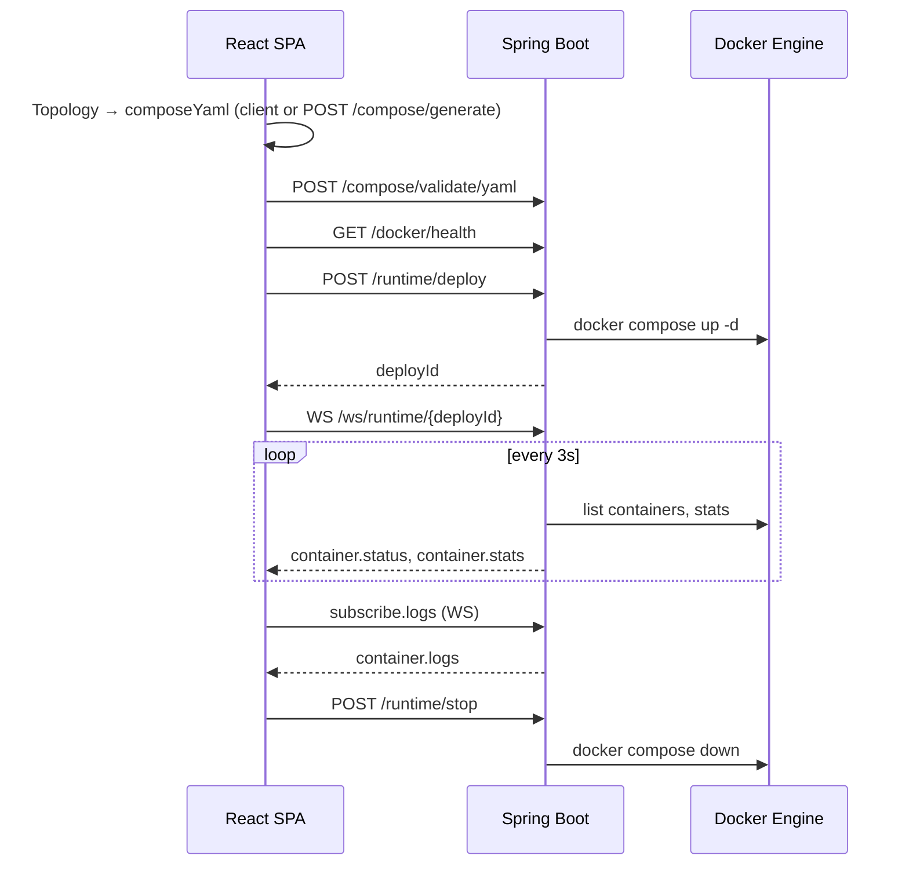

# 系统架构

> **语言：** [English](../en/ARCHITECTURE.md) · [中文](ARCHITECTURE.md)

**仓库：** [https://github.com/MMCISAGOODMAN/docker-compose-studio](https://github.com/MMCISAGOODMAN/docker-compose-studio)

Docker Compose Studio 是一款面向本地开发环境的可视化编排平台。开发者将服务拖拽至画布、完成配置后，即可导出或运行生产可用的 `docker-compose.yml`，无需记忆 Compose 语法。

## 设计目标

| 目标 | 实现方式 |
|------|----------|
| 快速迭代 | 客户端 Compose 生成可在无后端情况下工作 |
| 准确 YAML | 服务端 parse/generate/diff 处理复杂拓扑 |
| 本地运行时 | 通过宿主机 Docker Engine 一键部署 |
| 可扩展性 | JSON 服务目录、模板种子、浏览器 localStorage 自定义服务 |

## 高层架构

```
┌─────────────────────────────────────────────────────────────────────────┐
│                     React SPA (Vite + TypeScript)                       │
│  React Flow Canvas · Monaco Editor · Zustand Stores · Tailwind CSS      │
└───────────────────────────────┬─────────────────────────────────────────┘
                                │ REST /api/v1  ·  WebSocket /ws/runtime/*
                                ▼
┌─────────────────────────────────────────────────────────────────────────┐
│              Spring Boot 3 API (Java 21)                                │
│  Controllers · Services · JPA · Flyway · WebSocket Handler              │
└───────┬─────────────────┬──────────────────────┬──────────────────────┘
        │                 │                      │
        ▼                 ▼                      ▼
  PostgreSQL          Redis (预留)         Docker Engine
  (项目、模板、         用于未来              (compose up/stop、
   部署历史)            缓存/会话)            日志、指标)
```

开发模式下，Vite 将 `/api` 和 `/ws` 代理至后端 `8080` 端口。

## 运行时子系统（v0.2）

运行时层将生成的 compose 文件部署至本地 Docker Engine，并向 UI 推送实时遥测数据。

```
RuntimePanel (React)
    │ POST /api/v1/runtime/deploy
    │ POST /api/v1/runtime/stop
    │ GET  /api/v1/runtime/containers?deployId=
    │ WS   /ws/runtime/{deployId}
    ▼
RuntimeController · RuntimeWebSocketHandler
    ▼
DockerRuntimeService · DeploySessionManager
    ▼
docker compose CLI  +  docker-java API (health, stats, logs)
```

**部署流程**

1. 前端向 `POST /api/v1/runtime/deploy` 发送 `composeYaml` 及可选的 `projectName`。
2. `DockerRuntimeService` 在 `dcs.docker.deploy-dir` 下写入 YAML，执行 `docker compose up -d`，并注册带有 UUID `deployId` 的 `DeploySession`。
3. 前端打开 `WebSocket /ws/runtime/{deployId}`，接收容器状态（每 3 秒）、CPU/内存指标及可选日志流。
4. `POST /api/v1/runtime/stop` 执行 `docker compose down` 并销毁会话。

Docker 集成由 `DOCKER_ENABLED=true` 控制（见 `application.yml`）。全栈运行时，根目录 `docker-compose.yml` 将 `/var/run/docker.sock` 挂载进后端容器。

## 模块划分

### 前端（`frontend/`）

| 区域 | 职责 |
|------|------|
| `components/canvas/` | React Flow 拓扑图、从服务市场拖拽 |
| `components/marketplace/` | 服务目录 + 自定义服务对话框 |
| `components/config/` | 单服务 image、ports、volumes、env、healthcheck |
| `components/compose/` | Monaco YAML 编辑器、`ValidationPanel` |
| `components/runtime/` | 部署/停止、容器列表、日志、指标 |
| `components/templates/` | 内置 + 自定义模板库 |
| `lib/compose.ts` | 客户端 YAML 生成（可离线） |
| `lib/api.ts` | REST 客户端与 WebSocket URL 构建 |
| `stores/` | Zustand：project、runtime、theme、custom catalog/templates |

### 后端（`backend/`）

| 包 | 职责 |
|----|------|
| `controller/` | REST：compose、catalog、templates、AI、projects、docker health、**runtime** |
| `service/` | Compose parse/generate/diff、校验、catalog、templates、AI topology、**Docker runtime** |
| `websocket/` | `RuntimeWebSocketHandler` — 状态轮询与日志订阅 |
| `domain/` | JPA 实体：`Workspace`、`Project`、`Template`、`DeployRun` |
| `dto/` | 全部 API 的请求/响应 record |
| `resources/db/migration/` | Flyway  schema（`V1__init_schema.sql`） |

## 数据流：从图到运行中的容器



## 拓扑模型

前后端共享的画布图结构如下：

```json
{
  "nodes": [
    {
      "id": "node-1",
      "type": "serviceNode",
      "position": { "x": 100, "y": 200 },
      "data": {
        "catalogId": "postgres",
        "name": "postgres",
        "image": "postgres:16-alpine",
        "ports": [{ "host": 5432, "container": 5432 }],
        "volumes": [],
        "environment": { "POSTGRES_PASSWORD": "secret" }
      }
    }
  ],
  "edges": [
    { "id": "e1", "source": "node-2", "target": "node-1", "type": "dependency" }
  ]
}
```

边表示生成 compose 文件中的 `depends_on` 依赖关系。

## 部署模式

| 模式 | 后端 | 数据库 | Docker 运行时 |
|------|------|--------|---------------|
| 仅前端 | 不需要 | 不需要 | 不适用（仅导出 YAML） |
| 本地全栈 | `./mvnw spring-boot:run` | 通过 compose 启动 PostgreSQL + Redis | 宿主机 socket，`DOCKER_ENABLED=true` |
| Docker 一体化 | `docker compose up -d` | 包含在 compose 中 | socket 挂载至后端 |

## 安全与运维说明

- CORS 源通过 `dcs.cors.allowed-origins` 配置（默认包含 `http://localhost:5173`）。
- 部署工作目录为 `dcs.docker.deploy-dir` 下的临时目录；停止部署会清理 compose 项目资源。
- WebSocket 连接需要来自活跃 `DeploySession` 的有效 `deployId`。
- 项目持久化（CRUD）对 MVP 编辑为可选；编辑器在内存中维护状态，自定义模板与服务可存于 localStorage。

## 相关文档

- [API](API.md) — REST 与 WebSocket 契约
- [Database](DATABASE.md) — PostgreSQL  schema
- [Components](COMPONENTS.md) — React UI 结构
- [Entities](ENTITIES.md) — Java 领域模型
- [Roadmap](ROADMAP.md) — 发布计划
